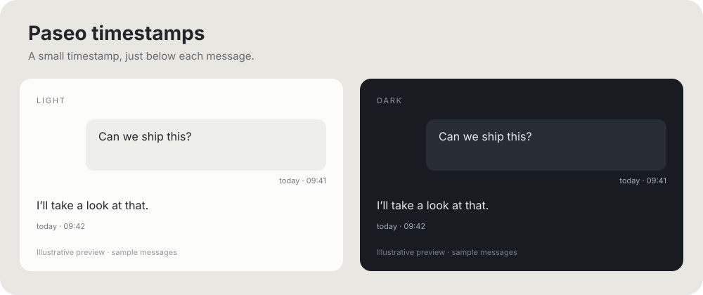

<p align="center">
  
</p>

# Paseo Timestamps

Small timestamps. Local dates. A clearer conversation.

Adds local date and time labels to user and assistant messages, with rendered assistant Markdown and colors from your Paseo theme. No account or additional service required.



## Install

Requires **Paseo 0.13.2 or later on both client and daemon**, with plugins enabled.

```sh
paseo plugin install git:dasheck0/paseo-timestamps --ref v1.0.0
```

For unreleased changes, use `--ref develop` instead. See the [release checklist](docs/releasing.md). To remove the plugin:

```sh
paseo plugin remove paseo-timestamps
```

## What you get

- **Local dates:** localized “today” / “yesterday”; otherwise your locale's date format, followed by local time.
- **Truthful timestamps:** uses the source date supplied by Paseo, including history. Invalid dates hide only the label.
- **Distinct messages:** selectable user text in a right-aligned bubble; assistant content through Paseo's themed Markdown renderer and streaming reveal hook.
- **Accessible labels:** the complete date, time, and timezone name supplied by the platform.

## Know before installing

**This plugin replaces message rows; it does not decorate the native renderer.** Exact native/custom styling, copy/rewind actions, and streaming presentation are not guaranteed. Native row actions are not recreated. User bubbles use the theme values available to plugins, not every native style setting.

Attachment-bearing or special messages stay native when recognizable. **Paseo can omit attachment metadata from the transformer input, so mixed text-and-attachment messages can lose their previews.** If attachments or complete native feature parity are essential, do not enable this renderer. Removing it restores native rendering without rewriting message history.

Other plugins that transform the same messages can take precedence. This plugin does not change their settings. See [compatibility](docs/compatibility.md) for details.

Client-only: no backend, credentials, analytics, or additional network requests.

## Development

```sh
npm ci --ignore-scripts
npm run lint
npm run build
npm run typecheck
npm test
npm run check:package
```

Node 22+ is required for development. `build` compiles the client TypeScript; Paseo bundles the published TypeScript entry point when loading the plugin. Installs intentionally skip lifecycle scripts. Tests mock host components and do not replace device testing.

Local installation: `paseo plugin install /path/to/paseo-timestamps`.

See [compatibility](docs/compatibility.md), [release preparation](docs/releasing.md), and the [changelog](CHANGELOG.md).

## License

MIT
